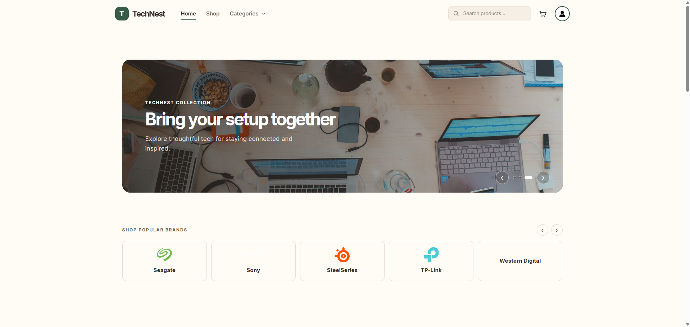
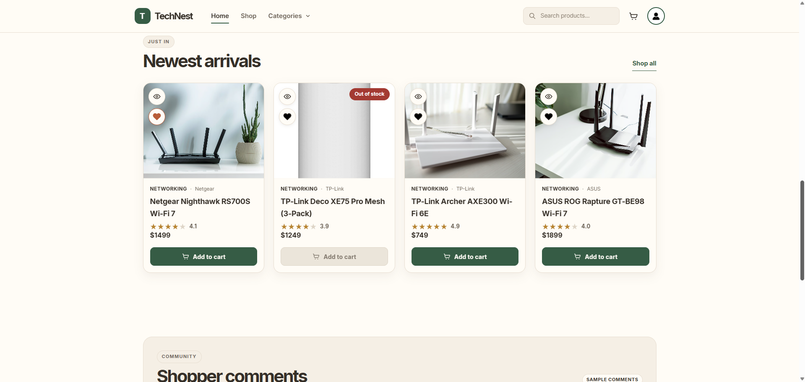
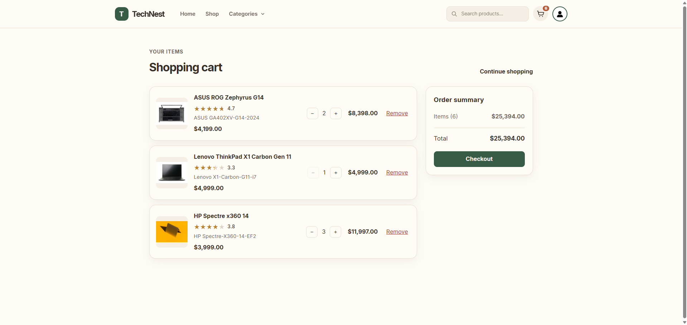
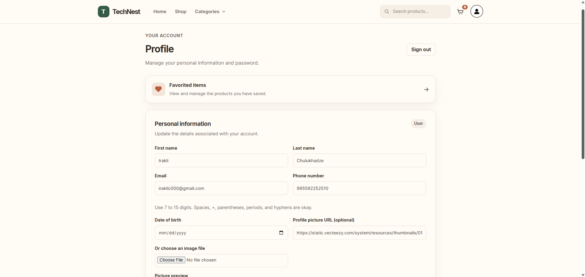

# Online Store

Angular online store using the ShopAPI.

## Features
- Browse categories and products
- Register, verify email, login
- Cart and favorites
- Profile, profile picture, information

## Home

## Cart

## Profile

## Tech
Angular, TypeScript, RxJS, signals

## Run
1. npm install
2. Set stepKey in src/environments/environment.ts
3. ng serve